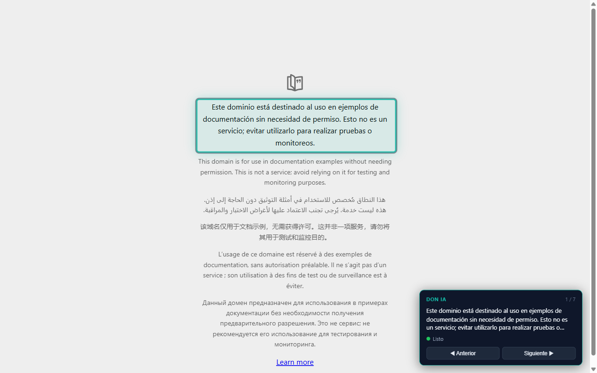

# Lector Accesible IA

Extensión de navegador (Chrome/Brave/Edge, Manifest V3) que recorre **cualquier página web** con el teclado y la lee en voz alta con una **voz clonada local**.

- **Voz**: Don IA (`df54e121`), clonada dentro de VoiceStudio en el equipo del usuario.
- **Sin nube**: ni el texto ni el audio salen de la computadora.
- **Toda la web**: el content script se inyecta en `<all_urls>`, no en una página concreta.
- **Navegación por `Tab`**: cada bloque se resalta, se muestra en la miniventana y se narra al detenerte.
- **Imágenes**: se narran por su etiqueta accesible (`alt`, `aria-label` o `title`), p. ej. *"Imagen. Wikipedia"*.
- **Miniventana flotante** con el texto actual, el estado (Procesando / Hablando / Listo) y el contador de bloques.



## Atajos

| Tecla | Acción |
|---|---|
| `Tab` | Bloque siguiente (se narra al detenerte ~0,3 s) |
| `Shift+Tab` | Bloque anterior |
| `Enter` | Activa el enlace o botón del bloque; en un campo de texto, entra a escribir |
| `Escape` | Sale del modo navegación |
| `Alt+Shift+N` | Activa o desactiva el modo navegación |

## Cobertura multisitio (medida el 13/11/2026)

El mismo código se probó en seis sitios con motores distintos. El inventario es lo que la extensión detecta como bloque navegable:

| Sitio | Tecnología | Bloques | Imágenes |
|---|---|---|---|
| `muni-theta.vercel.app` | React/Vite | 107 | 0 |
| `es.wikipedia.org/wiki/Ilave` | MediaWiki | 322 | 13 |
| `news.ycombinator.com` | HTML plano | 292 | 0 |
| `developer.mozilla.org` | MDN (docs largas) | 904 | 33 |
| `github.com/SZapana/LectorAccesibleIA` | SPA | 184 | 4 |
| `mozilla.org/es` | portal | 174 | 6 |

Los `iframe` no se narran (el content script corre con `all_frames: false`). En los seis sitios medidos, ningún `iframe` tenía contenido textual: el único encontrado (municipal) estaba vacío.

## v1.2.0 — GPU, caché de audio y prefetch

La v1.1.0 medía **140-162 s por bloque** porque VoiceStudio estaba fijado a CPU (`compute_device: "cpu"` en `prefs.json`), no por falta de hardware: el equipo tiene una RTX 3050 con 4 GB y torch `2.8.0+cu128`.

Con `compute_device: "auto"` y el backend reiniciado (`effective_family: "cuda"`), medido en esta máquina:

| Bloque | Audio generado | Síntesis en GPU | Coste |
|---|---|---|---|
| 30 caracteres | 105 KB (2,2 s de audio) | **2,0 s** | 3,5 KB/carácter |
| 181 caracteres | 593 KB (12,4 s) | **4,1 s** | 3,3 KB/carácter |
| 1090 caracteres | 3,4 MB (70,6 s) | **21,5 s** | 3,1 KB/carácter |

El motor genera ~3,3 veces más rápido que el tiempo real del audio. Sobre esa base, la v1.2.0 añade dos cosas:

| Capa | Qué hace |
|------|----------|
| `background/service-worker.js` | **Caché de audio en IndexedDB** (clave `docId:hash(texto)`, tope de 128 MB, purga a las 24 h). El audio se guarda **siempre**, incluso cuando se descarta porque el usuario se movió: es justo el que se reutiliza al volver. |
| `background/service-worker.js` | **Prefetch de ventana deslizante**: mientras suena el bloque N se generan N+1…N+4. Solo bloques de ≤300 caracteres (títulos, botones, enlaces), porque el motor no cancela trabajos y un párrafo largo bloquearía la demanda. La petición del usuario siempre tiene prioridad. |
| `content/navegacion.js` | `docId` aleatorio por carga del documento: al recargar la página la caché se invalida sola, sin permisos ni eventos de navegación extra. Antirrebote reducido a **0,3 s** y margen inicial a **0,3 s** (antes 0,7 s y 1,8 s, dimensionados para síntesis de minutos). |

Medido en Brave con perfil limpio contra el sitio municipal (107 bloques):

```
activación (síntesis fría) -> ▶ Hablando en  5817 ms
Tab 1  (cache hit)         -> ▶ Hablando en   341 ms
Tab 2  (cache hit)         -> ▶ Hablando en   356 ms
Shift+Tab (vuelve)         -> ▶ Hablando en   358 ms
caché: 3 entradas, 0,46 MB
```

Sin la GPU, el prefetch no tendría sentido: 904 bloques de MDN serían ~45 minutos de motor. Con GPU el límite real es el presupuesto de disco (128 MB ≈ 40 bloques medianos) y la VRAM, no el tiempo.

## v1.1.0 — cola coalescente y voz que se corta al cambiar de bloque

La v1.0.1 abortaba la petición anterior al llegar una nueva. Se midió que **VoiceStudio no cancela el trabajo cuando el cliente se desconecta**: una petición abortada a los 5 s seguida de otra tardó **293 s** (150 s del trabajo abandonado + la nueva). Abortar no ahorraba nada y acumulaba trabajos en el motor.

La v1.1.0 cambia el diseño:

| Capa | Qué hace |
|------|----------|
| `content/navegacion.js` | Antirrebote de 0,7 s por bloque; margen de 1,8 s al activar el modo para que una `Tab` inmediata no gaste una síntesis; al salir del modo invalida el audio en curso. |
| `background/service-worker.js` | **Una** síntesis en curso y, como mucho, **una** pendiente por pestaña, que se sobrescribe con la más reciente. Si el usuario se movió, el audio se descarta. El estado (`seq`, cancelación) es por pestaña, no global. |
| `proxy-tts.py` | `ThreadingHTTPServer`: `/health` responde aunque haya una síntesis en curso y el proxy sobrevive a la desconexión del cliente. |

Medido en Brave contra el sitio municipal (107 bloques), ráfaga de 4 `Tab`:

```
antes (v1.0.1): 5 peticiones encoladas en el motor
ahora (v1.1.0): 1 sola petición (seq=5); el audio del bloque 5/107 es el único que suena
/health durante la síntesis -> {"status": "ok", ...}
miniventana: Procesando voz... -> ▶ Hablando -> Listo
```

## Estado verificado (13/11/2026)

Prueba end-to-end en Brave con la extensión cargada descomprimida (`test-verify.cjs`):

```
[ráfaga de 4 Tab]
  NAV_HABLAR seq=5 len=49          <- una sola petición al motor
  synthesize end 157200 bytes 162445ms
  playAudio start -> playAudio fin
  miniventana: Procesando voz... -> ▶ Hablando -> Listo

[activar sin Tab]
  NAV_HABLAR seq=1 len=37
  synthesize end 123620 bytes 140428ms
  playAudio start -> playAudio fin
  miniventana: Procesando voz... -> ▶ Hablando -> Listo
```

`test-smoke.cjs` verifica además entrar/salir/reentrar: panel y anillo aparecen, desaparecen y vuelven a aparecer, el service worker recibe `NAV_CANCELAR` y no hay errores de consola.

## Descarga

- Repositorio: <https://github.com/SZapana/LectorAccesibleIA>
- Release `v1.2.0`: <https://github.com/SZapana/LectorAccesibleIA/releases/tag/v1.2.0>
- ZIP: <https://github.com/SZapana/LectorAccesibleIA/releases/download/v1.2.0/LectorAccesibleIA-1.2.0.zip>
- Release anterior `v1.1.0`: <https://github.com/SZapana/LectorAccesibleIA/releases/tag/v1.1.0>
- Release anterior `v1.0.1`: <https://github.com/SZapana/LectorAccesibleIA/releases/tag/v1.0.1>

## Estructura

```
extension/                 código que se empaqueta
  manifest.json            permisos y puntos de entrada
  background/              service worker: síntesis, offscreen, comandos
  content/navegacion.js    extracción de bloques, atajos, miniventana
  offscreen/               reproducción del audio (Web Audio 24 kHz mono)
  proxy-tts.py             proxy local de voz (3902 -> VoiceStudio 3900)
tools/
  empaquetar.js            genera dist/LectorAccesibleIA-<version>.zip
  INICIAR-PROXY.bat        lanzador del proxy para el usuario final
docs/
  COMO-INSTALAR.txt        instrucciones que viajan dentro del ZIP
  INSTALACION-EVALUADORES.md
  DISTRIBUCION-GRATUITA.md vías de publicación sin costo
  METADATOS-EDGE-ADDONS.md  textos listos para Microsoft Edge Add-ons
  PRIVACY.md               política de privacidad
dist/                      ZIP de distribución
```

## Arquitectura en una línea

`content script` (lee bloques) → `service worker` (pide voz a VoiceStudio vía proxy local) → `documento offscreen` (reproduce el PCM) → estado visible en la miniventana.

El proxy local es **imprescindible**: el navegador no puede presentar un origen `chrome-extension://` al motor local, y VoiceStudio rechaza esas peticiones por CSRF. Además, el allow-list `OMNIVOICE_ALLOWED_ORIGINS` de VoiceStudio solo acepta esquemas `http`, `https` y `app`, así que no se puede eliminar el proxy por configuración.

## Requisitos para probar

VoiceStudio abierto, `python proxy-tts.py` corriendo, y la extensión cargada descomprimida. Instrucciones: [`docs/INSTALACION-EVALUADORES.md`](docs/INSTALACION-EVALUADORES.md).

## Empaquetar

```powershell
node tools\empaquetar.js
```

Genera `dist/LectorAccesibleIA-1.0.0.zip` con el `manifest.json` en la raíz, el proxy incluido y el instructivo.
